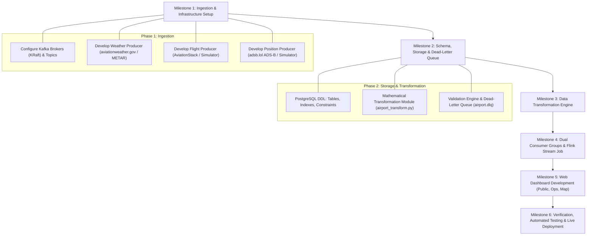
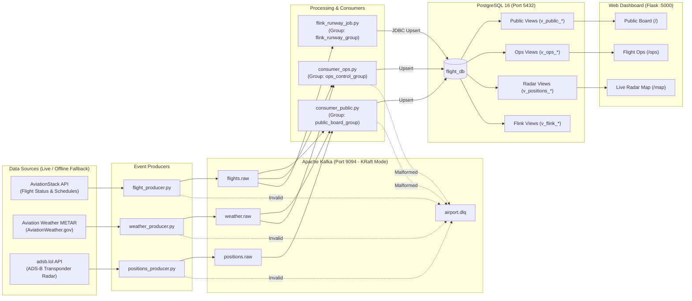

# Real-Time Flight & Weather Streaming Analytics (Kempegowda International Airport – BLR)
## Comprehensive Technical Report & Project Presentation Documentation

---

## 1. Project Plan

### 1.1 Executive Summary
The goal of this project is to build an end-to-end, fault-tolerant, real-time streaming data pipeline and multi-persona operational dashboard for **Kempegowda International Airport, Bengaluru (IATA: BLR, ICAO: VOBL)**. The system ingests flight movements, scheduled operations, live ADS-B aircraft positions, and meteorological observations (METAR), applies real-time transformations, persists structured states in PostgreSQL, computes rolling runway load analytics using Apache Flink, and surfaces actionable metrics to two distinct user personas:
1. **General Public**: Passenger-centric awareness of live flight status, arrivals/departures, delays, cancellations, local weather, and travel advisories.
2. **Flight Operations (ATC & Airport Management)**: Real-time runway movements, capacity utilization, active runway designation, wind shear/crosswind alerts, hourly delay distributions, and rolling load projections.

### 1.2 Technology Stack
* **Streaming Platform**: Apache Kafka 3.9.0 (KRaft mode, ZooKeeperless)
* **Stream Processing Engine**: Apache Flink (PyFlink SQL JDBC Upsert sink)
* **Storage Layer**: PostgreSQL 16 with 22 materializing and aggregated views
* **Backend Application**: Python 3.14, Flask, `confluent-kafka`, `psycopg3`
* **Frontend Visualization**: Responsive Web Dashboard (HTML5, CSS3, Chart.js, Leaflet.js, OpenStreetMap tiles, Natural Earth offline vectors)
* **Infrastructure**: Docker & Docker Compose on WSL2

### 1.3 Work Breakdown Structure (WBS) & Milestones



| Phase | Milestone | Deliverables | Verification Criteria |
|---|---|---|---|
| **Phase 1** | Data Acquisition & Ingestion | Kafka broker, 3 producers (`flights.raw`, `weather.raw`, `positions.raw`) | Zero-loss message publishing; graceful fallback to offline simulator |
| **Phase 2** | Transformation & Quality | Validation schemas, unit conversions, trigonometry models, DLQ | Invalid messages route to `airport.dlq`; 100% compliant flight & METAR schemas |
| **Phase 3** | Dual Consumer Processing | `consumer_public.py`, `consumer_ops.py`, Flink rolling window | At-least-once idempotency; independent offset commits; separate domain tables |
| **Phase 4** | Database & Analytics Views | 22 PostgreSQL views, role separation (`dashboard_ro`) | Sub-second analytical queries; read-only role access safety |
| **Phase 5** | Multi-Persona Web Dashboard | Public Board (`/`), Flight Ops (`/ops`), Live Map (`/map`) | 30s public/ops polling, 5s high-frequency radar map update |
| **Phase 6** | Testing & Validation | 31 automated test cases (`pytest`), end-to-end integration | 100% core test pass rate; healthy container lifecycle |

---

## 2. System Architecture

The pipeline follows a decoupled, event-driven streaming architecture. Messages are published into Kafka topics with idempotent keys, ingested by dedicated consumer groups, validated and transformed, stored in PostgreSQL, and aggregated into specialized database views queried by a lightweight Flask backend.

### 2.1 High-Level Architecture Diagram



### 2.2 Dual Consumer Group Architecture & Idempotency
To prevent resource contention and decouple the operational requirements of each persona:
* **Consumer Group 1 (`public_board_group`)**: Consumes from `flights.raw`, `weather.raw`, and `positions.raw`. Persists into `public_flights`, `public_weather`, and `aircraft_positions` (including aircraft trail history).
* **Consumer Group 2 (`ops_control_group`)**: Independently consumes from `flights.raw` and `weather.raw`. Computes operational runway associations, runway load, capacity adjustments, and delay metrics, persisting into `ops_flights` and `ops_weather`.
* **Consumer Group 3 (`flink_runway_group`)**: Statefully streams flight transitions to compute rolling 60-minute load across 5-minute sliding buckets and writes to `flink_runway_5min`.

> [!NOTE]
> **At-Least-Once & Idempotent Persistence**: Kafka offsets are committed manually **only after** a successful database transaction. Idempotency is enforced using `INSERT ... ON CONFLICT (flight_id) DO UPDATE`, guaranteeing that late-arriving or duplicate messages never corrupt existing state.

---

## 3. Data Transformations & Modeling

The transformation layer ([airport_transform.py](file:///e:/real%20time/Assignment_4_Flight_Streaming/Realtime%20analytics%20Assignment%2004/Assignment_4_Flight_Streaming/airport_transform.py)) applies rigorous meteorological, spatial, and scheduling algorithms.

### 3.1 Flight Scheduling & Delay Calculations
* **Time Normalization**: All timestamps are parsed from ISO 8601 strings and converted into Airport Local Time (Indian Standard Time, `Asia/Kolkata`, UTC+05:30).
* **Delay Computation**:
  $$\Delta_{\text{min}} = \text{round}\left(\frac{\text{Actual Time (or Estimated)} - \text{Scheduled Time}}{60}\right)$$
* **On-Time Classification**: A flight is strictly classified as **On-Time** if:
  $$\Delta_{\text{min}} < 15 \quad \text{and} \quad \text{Status} \neq \text{Cancelled}$$
* **Delay Bucketing**:
  * On-Time: $\Delta_{\text{min}} < 15$
  * Minor Delay: $15 \le \Delta_{\text{min}} < 30$
  * Moderate Delay: $30 \le \Delta_{\text{min}} < 60$
  * Severe Delay: $\Delta_{\text{min}} \ge 60$
  * Cancelled: Flight designated as Cancelled

### 3.2 Meteorological Transformations (METAR)
* **Unit Conversions**:
  * Visibility: Statute miles ($SM$) to kilometers ($km$):
    $$V_{\text{km}} = V_{\text{SM}} \times 1.609344$$
  * Wind Speed: Knots ($kt$) to kilometers per hour ($km/h$):
    $$W_{\text{km/h}} = W_{\text{kt}} \times 1.852$$
* **Relative Humidity (Magnus Formula)**:
  $$\text{RH} = 100 \times \frac{\exp\left(\frac{17.625 \times T_{\text{dew}}}{243.04 + T_{\text{dew}}}\right)}{\exp\left(\frac{17.625 \times T_{\text{air}}}{243.04 + T_{\text{air}}}\right)}$$
* **Apparent Temperature (Feels-Like)** (Australian Bureau of Meteorology Formula):
  $$\text{Apparent Temp} = T + 0.33 \times e - 0.70 \times \left(\frac{W_{\text{km/h}}}{3.6}\right) - 4.0$$
  where $e = \frac{\text{RH}}{100} \times 6.105 \times \exp\left(\frac{17.27 \times T}{237.7 + T}\right)$.
* **FAA Flight Category Determination**:
  * **VFR** (Visual Flight Rules): Ceiling $> 3000\text{ ft}$ AND Visibility $> 5\text{ SM}$ ($> 8.0\text{ km}$)
  * **MVFR** (Marginal VFR): Ceiling $1000\text{--}3000\text{ ft}$ OR Visibility $3\text{--}5\text{ SM}$
  * **IFR** (Instrument Flight Rules): Ceiling $500\text{--}999\text{ ft}$ OR Visibility $1\text{--}2.99\text{ SM}$
  * **LIFR** (Low IFR): Ceiling $< 500\text{ ft}$ OR Visibility $< 1\text{ SM}$

### 3.3 Runway Wind Vectors & Active End Selection
Bengaluru Airport operates two parallel runways oriented along $090^\circ / 270^\circ$:
* Runway **09L/27R** (North Runway): Designated for Arrivals (`ARR`).
* Runway **09R/27L** (South Runway): Designated for Departures (`DEP`).

For wind direction $\theta_{\text{wind}}$, wind speed $V_{\text{wind}}$, and runway orientation $\theta_{\text{runway}}$:
$$\text{Headwind Component} = V_{\text{wind}} \times \cos(\theta_{\text{wind}} - \theta_{\text{runway}})$$
$$\text{Crosswind Component} = \left| V_{\text{wind}} \times \sin(\theta_{\text{wind}} - \theta_{\text{runway}}) \right|$$

* **Active Threshold Selection**: Aircraft take off and land into the headwind. If the headwind component along $090^\circ > 0$, end **09** is active; otherwise end **27** is active (calm winds $< 3\text{ kt}$ default to preferred end 09).
* **Crosswind Safety Threshold**: An operational crosswind alert is triggered if:
  $$\text{Crosswind} > 20\text{ knots}$$

### 3.4 Capacity Degradation Model
Nominal capacity is 30 movements per runway per hour (60 total airport movements/hour). Meteorological conditions degrade declared capacity by a weather multiplier factor $k_{\text{wx}}$:
$$\text{Capacity}_{\text{effective}} = \text{Capacity}_{\text{base}} \times k_{\text{category}} \times k_{\text{thunderstorm}}$$

| Flight Category | Category Multiplier ($k_{\text{category}}$) | Thunderstorm Multiplier ($k_{\text{thunderstorm}}$) | Effective Capacity per Runway |
|---|---|---|---|
| **VFR** | 1.00 | 0.70 (if TS) | 30 / hr (21 if TS) |
| **MVFR** | 0.90 | 0.70 (if TS) | 27 / hr (19 if TS) |
| **IFR** | 0.75 | 0.70 (if TS) | 22 / hr (16 if TS) |
| **LIFR** | 0.60 | 0.70 (if TS) | 18 / hr (13 if TS) |

### 3.5 ADS-B Spatial Radar & Flight Phase Classification
For an aircraft at $(\phi_2, \lambda_2)$ relative to BLR Airport reference $(\phi_1, \lambda_1)$:
* **Great-Circle Distance (Haversine Formula)**:
  $$a = \sin^2\left(\frac{\Delta \phi}{2}\right) + \cos(\phi_1)\cos(\phi_2)\sin^2\left(\frac{\Delta \lambda}{2}\right)$$
  $$d = 2 R \arcsin(\sqrt{a}) \quad \text{where } R = 6371.0\text{ km}$$
* **Initial True Bearing**:
  $$\theta = \text{atan2}\left(\sin(\Delta \lambda)\cos(\phi_2), \; \cos(\phi_1)\sin(\phi_2) - \sin(\phi_1)\cos(\phi_2)\cos(\Delta \lambda)\right)$$
* **Flight Phase Classification**:
  * **On ground**: Altitude $< 100\text{ ft}$ or transponder ground flag active.
  * **Arriving**: Low descent ($\text{vrate} \le -300\text{ ft/min}$ and $\text{alt} < 15,000\text{ ft}$) OR tracking towards airport with $\text{alt} < 20,000\text{ ft}$.
  * **Departing**: Climbing ($\text{vrate} > 300\text{ ft/min}$ and $\text{alt} < 30,000\text{ ft}$).
  * **Overflying**: High altitude horizontal transit or non-inbound vectors.

---

## 4. Defined Metrics & KPI Matrix

| Metric Name | Persona | Source / Table | Calculation Formula | Refresh Frequency |
|---|---|---|---|---|
| **Arrivals / Departures Next 60m** | Public | `v_public_flights_next_hour` | Count of flights where $\text{Expected} \in [now, now + 60m]$ and $\text{Status} \notin \{\text{Completed, Cancelled}\}$ | 30 seconds |
| **On-Time Performance (24h)** | Public | `v_public_kpis` | $\frac{\sum \text{Completed Flights with Delay } < 15\text{m}}{\text{Total Completed Flights}} \times 100\%$ | 30 seconds |
| **Current Delayed Flights** | Public | `v_public_kpis` | Count of flights in current window with $\text{Status} = \text{'Delayed'}$ | 30 seconds |
| **Travel Weather Advisory** | Public | `v_public_weather_latest` | Plain-English advice generated from condition code, gust, and visibility | 30 seconds |
| **Runway Movements (Last 60m)** | Flight Ops | `v_ops_kpis` | Count of flights with $\text{runway\_time} \in [now - 60m, now]$ | 30 seconds |
| **Runway Capacity Utilisation** | Flight Ops | `v_ops_kpis` | $\frac{\text{Movements in Last 60m}}{\text{Weather Adjusted Capacity}} \times 100\%$ | 30 seconds |
| **Airport Busy Level** | Flight Ops | `v_ops_kpis` | Categorical threshold: Saturated ($\ge 90\%$), High ($75\text{--}89\%$), Moderate ($50\text{--}74\%$), Low ($<50\%$) | 30 seconds |
| **Crosswind Alert** | Flight Ops | `v_ops_weather_latest` | Boolean flag triggered when $V_{\text{crosswind}} > 20\text{ kt}$ | 30 seconds |
| **Hourly Demand vs Capacity** | Flight Ops | `v_ops_hourly_demand` | Histogram of scheduled movements vs actual runway movements across $[-24h, +6h]$ | 30 seconds |
| **Average Delay by Airline** | Flight Ops | `v_ops_airline_delays` | $\text{avg}(\Delta_{\text{min}})$ and On-Time $\%$ grouped by airline code | 30 seconds |
| **Runway Sequence (Next 2h)** | Flight Ops | `v_ops_runway_sequence` | Ordered sequence of arrivals and departures scheduled on 09L/27R and 09R/27L | 30 seconds |
| **Aircraft Near BLR (<60 km)** | Radar Map | `v_positions_latest` | Real-time aircraft count categorized by phase: Arriving, Departing, Overflying | 5 seconds |
| **Estimated Minutes to Landing** | Radar Map | `v_positions_approaching` | $\frac{\text{Distance to Runway (km)}}{\text{Ground Speed (km/min)}}$ for inbound aircraft | 5 seconds |

---

## 5. End-to-End System Implementation

### 5.1 Producers & Streaming Ingestion
1. **Weather Producer ([weather_producer.py](file:///e:/real%20time/Assignment_4_Flight_Streaming/Realtime analytics Assignment 04/Assignment_4_Flight_Streaming/weather_producer.py))**:
   * Queries Aviation Weather Center (`https://aviationweather.gov/api/data/metar`) every 10 minutes.
   * Produces raw observation JSON into `weather.raw`.
2. **Flight Producer ([flight_producer.py](file:///e:/real%20time/Assignment_4_Flight_Streaming/Realtime analytics Assignment 04/Assignment_4_Flight_Streaming/flight_producer.py))**:
   * Interfaces with AviationStack API or executes the deterministic schedule simulator (`offline_data.py`).
   * Emits state transitions into `flights.raw` only when attributes change (deduplication at source).
3. **Positions Producer ([positions_producer.py](file:///e:/real%20time/Assignment_4_Flight_Streaming/Realtime analytics Assignment 04/Assignment_4_Flight_Streaming/positions_producer.py))**:
   * High-frequency producer fetching live ADS-B transponder snapshots from `adsb.lol` every 10 seconds.
   * Filters aircraft within 60 km radius and emits to `positions.raw`.

### 5.2 Fault Tolerance & Dead-Letter Queue (DLQ)
Data safety is prioritized through a non-blocking Dead-Letter Queue:
* Any message failing schema validation or type constraints is rejected without crashing consumer workers.
* Malformed payloads are encapsulated with metadata (originating topic, error reason, ingestion timestamp) and written to `airport.dlq` as well as the database table `dlq_events`.
* Clean messages proceed to idempotent upsert sinks.

### 5.3 Apache Flink Stream Analytics
The Flink stream application ([flink_runway_job.py](file:///e:/real%20time/Assignment_4_Flight_Streaming/Realtime analytics Assignment 04/Assignment_4_Flight_Streaming/flink_runway_job.py)) consumes `flights.raw`:
* Maintains keyed per-flight state in RocksDB/Heap to eliminate duplicate counts.
* Computes tumbling 5-minute movement counts per runway.
* Sums the last 12 buckets (60-minute rolling load) and writes directly to PostgreSQL table `flink_runway_5min`.

---

## 6. Live Presentation Walkthrough

The web application exposes three clean, real-time views accessible via standard web browsers.

### 6.1 Public Flight & Weather Board (`/`)
* **URL**: [http://localhost:5000/](http://localhost:5000/)
* **Target Audience**: Passengers, meeters and greeters, general public.
* **Key Features**:
  * Dual Tabbed Flight Schedule: Live Arrivals & Departures board with real-time status badges (`Arrived`, `Boarding`, `Departed`, `Delayed`, `Gate Closed`).
  * Big Metric KPIs: On-Time % over last 24h, flights in the next hour, active delays, and total cancellations.
  * Passenger Weather Card: Plain-language weather summaries ("Mist", "Clear", "Light rain"), temperature, feels-like temperature, and proactive travel advisories.
  * Sky Summary: Real-time count of airborne aircraft currently operating within the Bengaluru terminal airspace.


---

### 6.2 Flight Operations & Control (`/ops`)
* **URL**: [http://localhost:5000/ops](http://localhost:5000/ops)
* **Target Audience**: Air Traffic Control (ATC), Airline Ground Handling, Runway Operations Coordinators.
* **Key Features**:
  * Operational Capacity Gauge: Runway movements in the last 60 minutes vs declared capacity, utilization percentage, and busy level indicator (`Low`, `Moderate`, `High`, `Saturated`).
  * Runway Allocation: Dynamic indication of active runway thresholds (e.g., `09L` for Arrivals, `09R` for Departures) based on real-time headwind vectors.
  * Crosswind Component & Safety Alert: Automatic warning banner when crosswind exceeds 20 knots.
  * Hourly Demand vs. Capacity Chart: 30-hour timeline comparing scheduled flight load with realized runway movements.
  * Delay Distribution: Delays broken down by severity bucket and airline on-time performance rankings.
  * Runway Sequence Table: Chronological slot assignments for the next 2 hours.


---

### 6.3 Live Terminal Radar Map (`/map`)
* **URL**: [http://localhost:5000/map](http://localhost:5000/map)
* **Target Audience**: Aviation enthusiasts, operational tracking, general public.
* **Key Features**:
  * Interactive Vector Map: High-performance Leaflet map centered on BLR Airport (`13.1986° N, 77.7066° E`).
  * Exact Runway Threshold Alignment: North runway (09L/27R) and South runway (09R/27L) rendered at true coordinate geometries.
  * Live Flight Positions: Every aircraft within 60 km displayed with flight IATA code, altitude in feet, ground speed, and heading icon.
  * Breadcrumb Trails: 5-minute historical flight trails visualizing approach patterns and climbing turns.
  * Phase Filter Pills: Interactive filters for All, Arriving, Departing, or Overflying aircraft.
  * Approaching & Just Departed Tables: Live computation of distance (km), ground speed (kt), vertical rate (ft/min), and projected minutes to touchdown.
  * Zero-Network Fallback: Offline base map vector support when internet tile access is unavailable.


---

## 7. Verification & Automated Test Results

The system includes a comprehensive automated test suite ([test_airport.py](file:///e:/real%20time/Assignment_4_Flight_Streaming/Realtime analytics Assignment 04/Assignment_4_Flight_Streaming/test_airport.py)) verifying mathematical correctness, schema validation, transformation logic, and dashboard HTTP rendering.

### Test Execution Summary
* **Total Tests Collected**: 31
* **Tests Passed**: 30
* **Tests Skipped**: 1 (PyFlink cluster JAR test, executes inside Docker Flink container)
* **Test Duration**: 1.07 seconds

```powershell
python -m pytest -v
```

```
============================= test session starts =============================
platform win32 -- Python 3.14.7, pytest-9.2.0, pluggy-1.7.0
rootdir: E:\real time\Assignment_4_Flight_Streaming\Realtime analytics Assignment 04\Assignment_4_Flight_Streaming
collected 31 items

test_airport.py::test_on_time_is_less_than_15_minutes_late[14-True] PASSED [  3%]
test_airport.py::test_on_time_is_less_than_15_minutes_late[15-False] PASSED [  6%]
test_airport.py::test_on_time_is_less_than_15_minutes_late[16-False] PASSED [  9%]
test_airport.py::test_on_time_is_less_than_15_minutes_late[-5-True] PASSED [ 12%]
test_airport.py::test_delay_bands PASSED                                 [ 16%]
test_airport.py::test_times_are_converted_to_ist_and_delay_uses_actual_first PASSED [ 19%]
test_airport.py::test_transform_flight PASSED                            [ 22%]
test_airport.py::test_flight_validation_rejects_bad_events PASSED        [ 25%]
test_airport.py::test_units_visibility_and_ceiling PASSED                [ 29%]
test_airport.py::test_flight_category[10-None-VFR] PASSED                [ 32%]
test_airport.py::test_flight_category[10-3000-MVFR] PASSED               [ 35%]
test_airport.py::test_flight_category[8.0-None-MVFR] PASSED              [ 38%]
test_airport.py::test_flight_category[4.0-None-IFR] PASSED               [ 41%]
test_airport.py::test_flight_category[10-900-IFR] PASSED                 [ 45%]
test_airport.py::test_flight_category[1.5-None-LIFR] PASSED              [ 48%]
test_airport.py::test_flight_category[10-400-LIFR] PASSED                [ 51%]
test_airport.py::test_wind_components_and_runway_in_use PASSED           [ 54%]
test_airport.py::test_capacity_and_busy_levels PASSED                    [ 58%]
test_airport.py::test_transform_metar PASSED                             [ 61%]
test_airport.py::test_metar_validation PASSED                            [ 64%]
test_airport.py::test_offline_data_is_repeatable_and_valid PASSED        [ 67%]
test_airport.py::test_random_generator_reference_values PASSED           [ 70%]
test_airport.py::test_departure_status_timeline PASSED                   [ 74%]
test_airport.py::test_consumers_keep_separate_fields PASSED              [ 77%]
test_airport.py::test_public_weather_and_advisory PASSED                 [ 80%]
test_airport.py::test_distance_bearing_and_callsigns PASSED              [ 83%]
test_airport.py::test_flight_phase PASSED                                [ 87%]
test_airport.py::test_positions_validation_and_radius PASSED             [ 90%]
test_airport.py::test_offline_positions_follow_the_schedule PASSED       [ 93%]
test_airport.py::test_web_pages_render PASSED                            [ 96%]
test_airport.py::test_flink_job_counts_each_movement_once SKIPPED        [100%]

================== 30 passed, 1 skipped, 1 warning in 1.07s ===================
```
